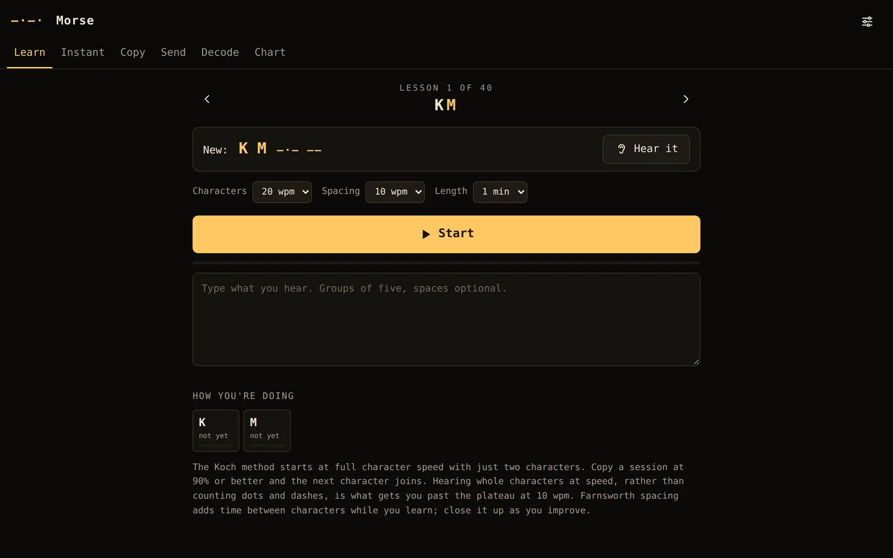
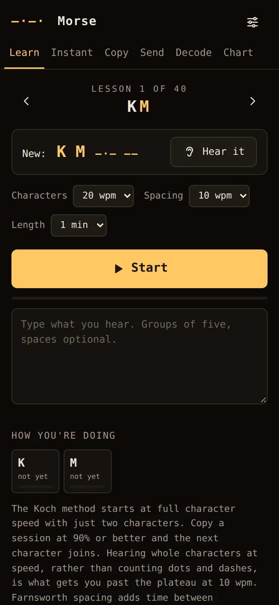

# Morse Trainer

[](https://github.com/ali-raheem/morse-trainer/actions/workflows/ci.yml) [](https://github.com/ali-raheem/morse-trainer/actions/workflows/pages.yml)

**▶ Try it live: [shoryuken.me/morse](https://shoryuken.me/morse/)** · mirror on [GitHub Pages](https://ali-raheem.github.io/morse-trainer/) · installable, works offline

<p align="center">
  <a href="https://shoryuken.me/morse/"></a>
  <a href="https://shoryuken.me/morse/"></a>
</p>

Learn and practise Morse code in the browser. Installable, and works offline.

- **Learn:** Koch-method lessons. You start at full character speed with just K and M,
  copy a session of random five-character groups, and score it. At 90% the next character
  joins, in the Koch order (K M U R E S N A P T L W I . J Z = F O Y , V G 5 / Q 9 2 H 3 8
  B ? 4 7 C 1 D 6 0 X). Groups lean towards the newest and the weakest characters.
  Farnsworth spacing adds time between characters without slowing them down.
- **Instant:** hear one character, press its key (or tap it) as fast as you can. Reaction
  times are tracked per character, and slow or missed ones come back more often.
- **Copy:** common words, on-air abbreviations and Q-codes, callsigns, or short exchanges
  like a real contact. Type what you heard and press Enter.
- **Send:** practise on a straight key (hold the button or the space bar) or iambic paddles
  (mode B: two buttons, `[`/`]` or the arrow keys). The decoder adapts to your speed and
  shows what you sent.
- **Decode:** listens through the microphone. It finds the tone, follows the speed and
  writes out what it hears. The audio stays in the browser.
- **Chart:** every character and prosign. Tap one to hear it.

Settings: character speed (5–45 wpm), effective speed, tone (350–1,000 Hz) and volume.
Progress and per-character stats are kept in this browser (`localStorage`, key `morse.v1`).

## How it works

- `js/morse.js`: the code table, the Koch order, and timing. A dit is 1.2/wpm seconds
  (PARIS, 50 units, is one word). Farnsworth gaps follow the ARRL formula. `schedule()`
  turns text into key-down intervals.
- Playback schedules every element on one oscillator with 5 ms ramps, so there are no
  clicks, and follows along with per-character timers.
- The decoder (`js/decoder.js`) classifies each key-down as a dit or dah against a running
  dit estimate, and each gap as an element, character or word space. It serves both the
  practice key and the microphone.
- The microphone path is an AudioWorklet (`js/tone-worklet.js`) running a Goertzel filter at
  the tone frequency every 128 samples, with an FFT to find the pitch. Adaptive
  noise-floor and peak trackers set a threshold with hysteresis, and the result feeds
  the same decoder.

## Run it

```bash
npm run serve   # python3 -m http.server 8080 (the microphone needs localhost or HTTPS)
npm test        # node --test, no dependencies
```

## Licence

[MIT](LICENSE) © 2026 Ali Raheem.
